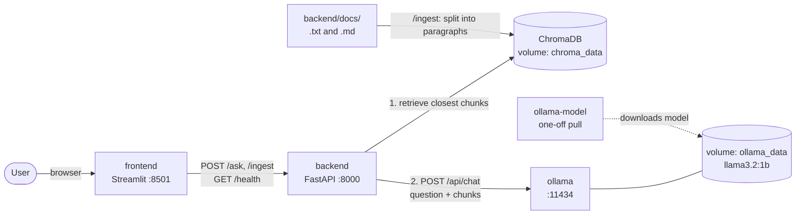

# RAG API Assistant

A question answering app for a small set of course notes. You ask a question in a Streamlit page, the FastAPI backend finds the most relevant passages in ChromaDB, and a local Ollama model writes an answer from those passages. Everything runs in Docker Compose, so nothing is sent to an outside service.

## Architecture



**Request flow for `/ask`:** the frontend sends the question to the backend, which looks up the closest chunks in ChromaDB. If any are close enough, the backend sends them with the question to Ollama and returns the answer with its sources. Otherwise it answers directly without calling Ollama.

**Startup order:** `ollama` (healthy) → `ollama-model` (exits after the pull) → `backend` (healthy) → `frontend`.

**Failures from Ollama** are returned by the backend as clear errors: 503 if Ollama is not running, 504 on a timeout, and 502 for an error status or an unusable response. The frontend shows the message.

## How it works

1. On ingest, each `.txt` and `.md` file in `backend/docs/` is split into paragraphs. Each paragraph is stored in ChromaDB as one chunk.
2. When you ask a question, ChromaDB returns the closest chunks by cosine distance. Chunks farther than `MAX_DISTANCE` are dropped.
3. The distance of the best chunk sets a confidence level: high, medium, low, or none.
4. With no chunks the API says it has no relevant information, and with low confidence it asks you to rephrase. Neither case calls the model.
5. Otherwise the chunks go into the system prompt and the question is sent to Ollama. The answer comes back with the source chunks.

## Services

| Service | Port | Purpose |
|---|---|---|
| frontend | 8501 | Streamlit chat page |
| backend | 8000 | FastAPI app with ChromaDB |
| ollama | 11434 | Local LLM server |
| ollama-model | none | One-off container that pulls `llama3.2:1b` |

The backend waits for the model pull to finish before it starts, so the first `docker compose up` takes a while.

## Running it

You need Docker with Compose. Copy the example environment file and start everything:

```bash
cp .env.example .env
docker compose up --build
```

Open http://localhost:8501. Click "Re-index Documents" in the sidebar the first time so the notes are loaded into ChromaDB.

If you change `app.py` or any backend code, run `docker compose up --build` again. The code is copied into the image at build time, so a plain `up` reuses the old one.

If port 8501 is already in use, a local Streamlit process is probably still running. Find it with `lsof -nP -iTCP:8501 -sTCP:LISTEN` and stop it with `kill <PID>`.

## Configuration

These are set in `.env` and read in `backend/config.py`.

| Variable | Default | Meaning |
|---|---|---|
| `OLLAMA_URL` | `http://localhost:11434` | Where the backend reaches Ollama. Compose uses `http://ollama:11434`. |
| `MODEL_NAME` | `llama3.2:1b` | Ollama model used for answers |
| `OLLAMA_TIMEOUT` | `120` | Seconds to wait for Ollama before returning a 504 |
| `CHROMA_PATH` | `./chroma_data` | Where ChromaDB stores its data. Compose sets it to `/app/chroma_data`, the mounted volume. |
| `COLLECTION_NAME` | `documents_cosine` | ChromaDB collection name |
| `MAX_RESULTS` | `3` | Chunks retrieved per question |
| `MAX_DISTANCE` | `0.9` | Chunks farther than this are discarded |
| `CONFIDENCE_THRESHOLD` | `0.5` | Best distance below this is "high" |
| `MEDIUM_CONFIDENCE_THRESHOLD` | `0.8` | Best distance below this is "medium", otherwise "low" |
| `DOCS_DIRECTORY` | `./docs` | Folder of documents to ingest |
| `DEBUG` | `false` | Print the settings on startup |

The frontend reads `API_URL`, which defaults to `http://localhost:8000`. Compose sets it to `http://backend:8000`. It also reads an optional `ASK_TIMEOUT` (default `150` seconds), which should stay above `OLLAMA_TIMEOUT`.

## API

| Method | Path | Description |
|---|---|---|
| POST | `/ask` | Body: `{"question": "..."}`. Optional `n_result` and `max_distance`. Returns `answer`, `sources`, and `confidence`. |
| POST | `/ingest` | Reads the docs folder and upserts its chunks. Safe to run repeatedly. |
| GET | `/health` | Reports ChromaDB status, Ollama status, and the document count. |
| GET | `/stats` | Reports the chunk count, model name, and database path. |

FastAPI also serves interactive docs at http://localhost:8000/docs.

Example:

```bash
curl -X POST http://localhost:8000/ask \
  -H "Content-Type: application/json" \
  -d '{"question": "What is a REST API?"}'
```

## Adding documents

Put `.txt` or `.md` files in `backend/docs/`, rebuild the backend, and click "Re-index Documents". Paragraphs are separated by blank lines, so keep each idea in its own paragraph. Ingest only adds and updates chunks. If you delete or rename a file, its old chunks stay in the database until you clear the volume with `docker compose down -v`.

## Notes and limits

- The model is small. `llama3.2:1b` sometimes refuses to answer even when the context has the answer. Temperature is set to 0 in the Ollama request to keep results consistent. A larger model in `MODEL_NAME` helps more than any prompt change.
- The first question after startup is slower because Ollama has to load the model.
- Confidence only looks at the single closest chunk. The other retrieved chunks can be weaker matches.

## Project layout

```
backend/
  my_rag_api.py     FastAPI app, retrieval, and generation
  config.py         Settings read from environment variables
  docs/             Source documents
frontend/
  app.py            Streamlit page
docker-compose.yml
.env.example
```
